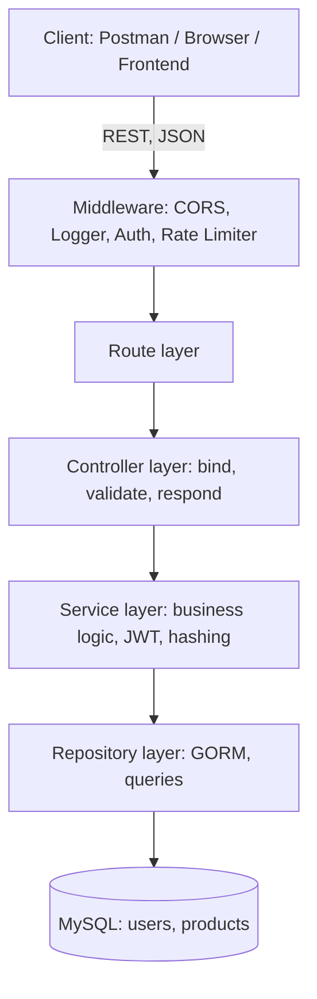

# Product Management REST API

A production-style REST API for product management, built with **Go**, **Gin**, **GORM** and **MySQL**. It features JWT authentication, per-IP rate limiting, CORS support, a one-command database reset and seeder, and a fully containerized setup with Docker.


---

## Table of Contents

- [Overview](#overview)
- [Features](#features)
- [Tech Stack](#tech-stack)
- [Architecture](#architecture)
- [Project Structure](#project-structure)
- [Getting Started](#getting-started)
- [Configuration](#configuration)
- [CLI Commands](#cli-commands)
- [API Reference](#api-reference)
- [Rate Limiting](#rate-limiting)
- [API Testing with Postman](#api-testing-with-postman)
- [Screenshots](#screenshots)
- [Design Decisions](#design-decisions)
- [Roadmap](#roadmap)
- [Contributing](#contributing)
- [License](#license)
- [Author](#author)

---

## Overview

This service exposes a RESTful API for managing products and authenticating users. It follows a **clean layered architecture** (`route → controller → service → repository → model`) with dependency injection, which keeps HTTP concerns, business logic and data access cleanly separated and easy to test.

| Capability | Summary |
|---|---|
| **Authentication** | JWT access and refresh tokens; passwords hashed with bcrypt |
| **Abuse protection** | Per-IP rate limiting on authentication and write endpoints |
| **Interoperability** | CORS enabled so web apps from any domain can consume the API |
| **Developer experience** | `fresh:migrate --seeder` drops, recreates and seeds the database in one command |
| **Deployment** | Multi-stage Dockerfile and `docker-compose` for reproducible environments |

---

## Features

### Product management

- Create products with server-side validation (`title`, `price > 0`, `category`, at least one `image`)
- List products with **search** (`?search=`), **category filter** (`?category=`) and **pagination** (`?limit=&page=`)
- Retrieve a product by ID, with a proper `404 Not Found` response
- Update products with `updated_by` / `updated_at` audit tracking
- Delete products (soft delete via `gorm.DeletedAt`)

### Authentication and security

- User registration with password confirmation
- Login returns an `authentication_token` (access token, 15 min) and a `refresh_token` (7 days)
- Passwords hashed with bcrypt
- JWT validation middleware on all protected routes (claims: `sub`, `username`, `type`, `exp`, `iat`)
- Per-IP rate limiting (see [Rate Limiting](#rate-limiting))
- Parameterized queries via GORM to prevent SQL injection
- CORS enabled for all origins (development-friendly default)

### Data layer

- GORM auto-migration
- Custom `JSONStringSlice` type to store image URL arrays as JSON in MySQL
- Automatic timestamps (`created_at`, `updated_at`)
- Audit fields: `created_by`, `created_by_id`, `updated_by`, `updated_by_id`

### Tooling

- Multi-stage, Alpine-based Docker image
- `docker-compose.yml` running the API and MySQL together
- Built-in CLI in `main.go` for serving, resetting and seeding
- Environment-based configuration via `.env` (godotenv)

---

## Tech Stack

| Layer | Technology |
|---|---|
| Language | Go 1.24 |
| Web framework | Gin 1.10 |
| ORM | GORM 1.25 + MySQL driver |
| Database | MySQL 8.0 |
| Authentication | `golang-jwt/jwt/v5`, bcrypt |
| Rate limiting | `golang.org/x/time/rate` |
| CORS | `gin-contrib/cors` |
| Configuration | `joho/godotenv` |
| Containerization | Docker, Docker Compose |

---

## Architecture



| Layer | Responsibility |
|---|---|
| **Middleware** | Cross-cutting concerns: CORS, logging, JWT validation, rate limiting |
| **Route** | Router setup and route grouping (public vs. protected) |
| **Controller** | Parse and validate requests, format HTTP responses |
| **Service** | Business rules, token generation, password hashing |
| **Repository** | Data access through GORM; the only layer that touches the database |
| **Model** | GORM entities (`User`, `Product`) |

---

## Project Structure

```text
product-api/
├── config/
│   └── config.go                 # Environment variable loading
├── controller/
│   ├── auth_controller.go        # Auth HTTP handlers
│   └── product_controller.go     # Product HTTP handlers
├── database/
│   └── database.go               # DB connection + FreshMigrate
├── middleware/
│   ├── auth.go                   # JWT validation
│   ├── cors.go                   # CORS configuration
│   └── rate_limit.go             # Per-IP rate limiter
├── model/
│   └── model.go                  # GORM models (User, Product)
├── repository/
│   ├── product_repository.go     # Product data access
│   └── user_repository.go        # User data access
├── route/
│   └── routes.go                 # Router setup
├── seeder/
│   └── seeder.go                 # Demo data seeder
├── service/
│   ├── auth_service.go           # Auth business logic
│   └── product_service.go        # Product business logic
├── docs/                         # API documentation assets
├── .env.example                  # Environment template
├── .dockerignore
├── Dockerfile
├── docker-compose.yml
├── go.mod
├── go.sum
├── main.go                       # CLI entry point
└── README.md
```

---

## Getting Started

### Prerequisites

- [Go 1.24+](https://go.dev/dl/)
- MySQL 8.0+ (or XAMPP / Laragon)
- [Docker Desktop](https://www.docker.com/products/docker-desktop/) (optional)
- [Postman](https://www.postman.com/downloads/) (optional)

### Option 1: Run locally

```bash
# 1. Clone the repository
git clone https://github.com/YOUR_USERNAME/product-api.git
cd product-api

# 2. Create the database
mysql -u root -p -e "CREATE DATABASE product_api;"

# 3. Configure environment variables
cp .env.example .env
# then edit .env to match your MySQL credentials

# 4. Install dependencies
go mod tidy

# 5. Migrate and seed the database
go run main.go fresh:migrate --seeder

# 6. Start the server
go run main.go serve
```

The API is now available at `http://localhost:8080`.

### Option 2: Run with Docker

```bash
# 1. Clone the repository
git clone https://github.com/YOUR_USERNAME/product-api.git
cd product-api

# 2. Build the image
docker compose build

# 3. Start MySQL and wait until it is healthy (~30 seconds)
docker compose up -d mysql
docker compose ps

# 4. Migrate and seed the database
docker compose run --rm api ./server fresh:migrate --seeder

# 5. Start the API
docker compose up -d api
```

The API is now available at `http://localhost:8080`.

### Demo account

Created by the seeder:

| Username | Password |
|---|---|
| `jhon_doe` | `supersecret` |

> **Warning:** Demo credentials are for development only. Change or remove them before deploying to production.

---

## Configuration

Create a `.env` file in the project root (a template is provided in `.env.example`):

| Variable | Example | Description |
|---|---|---|
| `DB_HOST` | `127.0.0.1` | MySQL host |
| `DB_PORT` | `3306` | MySQL port |
| `DB_USER` | `root` | MySQL user |
| `DB_PASSWORD` | *(empty)* | MySQL password |
| `DB_NAME` | `product_api` | Database name |
| `JWT_SECRET` | `your-super-secret-jwt-key-min-32-chars` | Signing key for JWTs (use 32+ random characters) |
| `JWT_ACCESS_EXPIRY` | `15m` | Access token lifetime |
| `JWT_REFRESH_EXPIRY` | `168h` | Refresh token lifetime (7 days) |
| `SERVER_PORT` | `8080` | HTTP server port |
| `CACHE_TTL` | `60s` | Cache time-to-live |

> Never commit your real `.env` file. Generate a strong secret with `openssl rand -hex 32`.

---

## CLI Commands

| Command | Description |
|---|---|
| `go run main.go serve` | Start the HTTP server |
| `go run main.go fresh:migrate` | Drop all tables and re-run migrations |
| `go run main.go fresh:migrate --seeder` | Drop, re-migrate and seed demo data |

---

## API Reference

**Base URL:** `http://localhost:8080`

Protected endpoints require the header `Authorization: Bearer <authentication_token>`.

### Endpoints

| Method | Endpoint | Auth | Description |
|---|---|:---:|---|
| `POST` | `/api/auth/register` | No | Register a new user |
| `POST` | `/api/auth/login` | No | Log in and receive JWT tokens |
| `GET` | `/api/products` | No | List products (search, filter, pagination) |
| `GET` | `/api/products/:id` | No | Get product details |
| `POST` | `/api/products` | Yes | Create a product |
| `PUT` | `/api/products/:id` | Yes | Update a product |
| `DELETE` | `/api/products/:id` | Yes | Delete a product |

### Query parameters for `GET /api/products`

| Parameter | Example | Description |
|---|---|---|
| `search` | `?search=T-Shirt` | Search by title (`LIKE`) |
| `category` | `?category=Clothes` | Filter by category (exact match) |
| `limit` | `?limit=10` | Items per page (default: `10`) |
| `page` | `?page=2` | Page number (default: `1`) |

### HTTP status codes

| Code | Meaning |
|---|---|
| `200 OK` | Request succeeded |
| `201 Created` | Resource created |
| `400 Bad Request` | Validation failed |
| `401 Unauthorized` | Missing, invalid or expired token |
| `404 Not Found` | Resource does not exist |
| `429 Too Many Requests` | Rate limit exceeded |

### Examples

<details>
<summary><b>Register</b></summary>

```bash
curl -X POST http://localhost:8080/api/auth/register \
  -H "Content-Type: application/json" \
  -d '{
    "username": "jhon_doe",
    "password": "supersecret",
    "password_confirmation": "supersecret"
  }'
```

Response `201 Created`:

```json
{
  "message": "User berhasil didaftarkan",
  "user": {
    "id": 1,
    "username": "jhon_doe"
  }
}
```

</details>

<details>
<summary><b>Login</b></summary>

```bash
curl -X POST http://localhost:8080/api/auth/login \
  -H "Content-Type: application/json" \
  -d '{"username": "jhon_doe", "password": "supersecret"}'
```

Response `200 OK`:

```json
{
  "authentication_token": "eyJhbGciOiJIUzI1NiIs...",
  "refresh_token": "eyJhbGciOiJIUzI1NiIs..."
}
```

</details>

<details>
<summary><b>Create a product</b></summary>

```bash
curl -X POST http://localhost:8080/api/products \
  -H "Content-Type: application/json" \
  -H "Authorization: Bearer <TOKEN>" \
  -d '{
    "title": "Awesome T-Shirt",
    "price": 99.99,
    "description": "High-quality cotton t-shirt",
    "category": "Clothes",
    "images": ["https://picsum.photos/640/480"]
  }'
```

Response `201 Created`:

```json
{
  "id": 1,
  "title": "Awesome T-Shirt",
  "price": 99.99,
  "description": "High-quality cotton t-shirt",
  "category": "Clothes",
  "images": ["https://picsum.photos/640/480"],
  "created_at": "2026-10-13T12:26:04+07:00",
  "created_by": "jhon_doe",
  "created_by_id": "1",
  "updated_at": "2026-10-13T12:26:04+07:00",
  "updated_by": "jhon_doe",
  "updated_by_id": "1"
}
```

</details>

<details>
<summary><b>List, search, filter and paginate</b></summary>

```bash
# Search by title
curl "http://localhost:8080/api/products?search=T-Shirt"

# Filter by category
curl "http://localhost:8080/api/products?category=Electronics"

# Pagination
curl "http://localhost:8080/api/products?limit=2&page=1"

# Combined
curl "http://localhost:8080/api/products?search=Wallet&category=Accessories&limit=5"
```

</details>

---

## Rate Limiting

Limits are enforced per client IP address. Requests over the limit receive `429 Too Many Requests`.

| Scope | Endpoints | Limit |
|---|---|---|
| Authentication | `POST /api/auth/register`, `POST /api/auth/login` | 3 requests / 60 seconds |
| Product writes | `POST`, `PUT`, `DELETE` on `/api/products` | 1 request / 5 seconds |

To verify: send 4 login requests within 60 seconds (the 4th returns `429`), or 2 `POST /api/products` requests within 5 seconds (the 2nd returns `429`).

---

## API Testing with Postman

Import `postman_collection.json` (located in the project root) to test every endpoint.

**Suggested flow**

1. `POST /api/auth/login` and copy `authentication_token`
2. `POST /api/products` to create a product (Bearer token)
3. `GET /api/products` and `GET /api/products/:id` to read
4. `PUT /api/products/:id` to update (Bearer token)
5. `DELETE /api/products/:id` to delete (Bearer token)

**Environment variables**

| Variable | Value |
|---|---|
| `base_url` | `http://localhost:8080` |
| `token` | The `authentication_token` from the login response |

---

## Screenshots

<details>
<summary><b>API responses</b></summary>

| Login | Product list |
|---|---|
|  |  |

| Create product | Rate limit (429) |
|---|---|
|  |  |

</details>

<details>
<summary><b>Docker deployment</b></summary>

| Containers running | Migrate and seed output |
|---|---|
|  |  |

</details>

---

## Design Decisions

- **Go**: High performance, efficient concurrency (goroutines), static typing and fast compilation make it a strong fit for APIs that serve many concurrent requests.
- **Gin**: A mature, high-performance framework with a rich middleware ecosystem, clean routing and built-in binding and validation.
- **GORM**: Removes CRUD boilerplate and provides auto-migration, hooks and soft delete.
- **JWT**: Stateless authentication that scales horizontally without server-side sessions. The access and refresh token pair balances security and user experience.
- **Rate limiting**: Protects login and registration from brute-force attacks and limits abuse of write endpoints.
- **Layered architecture**: Separating controller, service, repository and model keeps responsibilities clear and makes the code easier to test, maintain and extend across a team.

---

## Roadmap

**Shipped**

- [x] Product CRUD
- [x] JWT authentication (access and refresh tokens)
- [x] bcrypt password hashing
- [x] Per-IP rate limiting
- [x] CORS support
- [x] Search, filter and pagination
- [x] Soft delete
- [x] Docker and Docker Compose (multi-stage build)
- [x] Fresh migrate and seeder command
- [x] Input validation
- [x] Environment-based configuration

**Planned**

- [ ] Redis caching
- [ ] File upload for product images
- [ ] Categories as a separate table
- [ ] Unit tests (testify + mockery)
- [ ] CI/CD with GitHub Actions
- [ ] API versioning (`/api/v1`)
- [ ] Swagger / OpenAPI documentation UI
- [ ] Email verification on registration
- [ ] Kubernetes manifests

---

## Contributing

Contributions, issues and feature requests are welcome.

1. Fork the repository
2. Create a feature branch: `git checkout -b feature/amazing-feature`
3. Commit your changes: `git commit -m "Add amazing feature"`
4. Push to the branch: `git push origin feature/amazing-feature`
5. Open a Pull Request

---

## 📄 License

This project is licensed under the **MIT License** — see the [LICENSE](https://tlo.mit.edu/resources/mit-github) file for details.

---

## Author

<div align="center">


### Eben Nezer Manurung

Full Stack Developer • Backend Engineer


<br/>

If this project helped you, please consider giving it a ⭐

</div>
